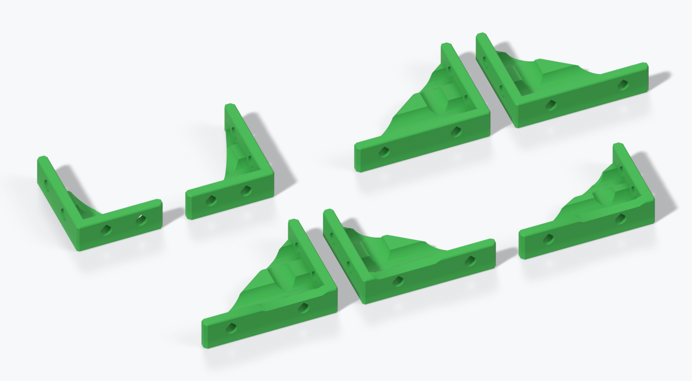
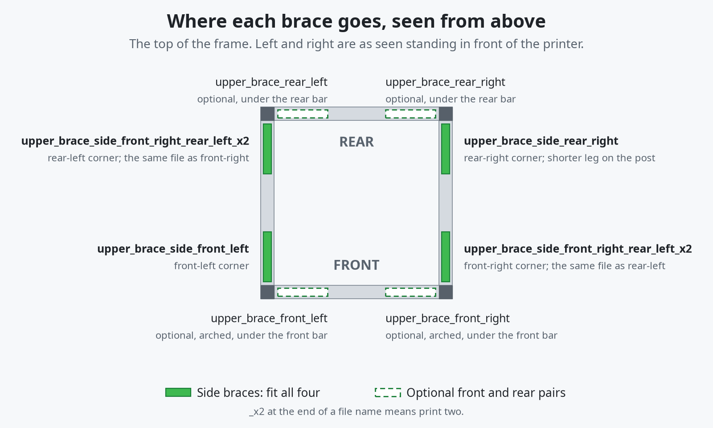
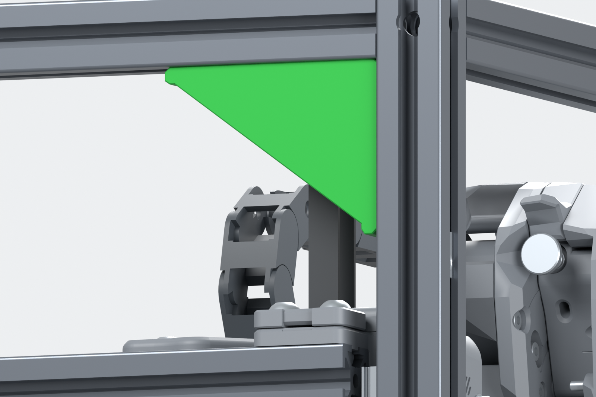
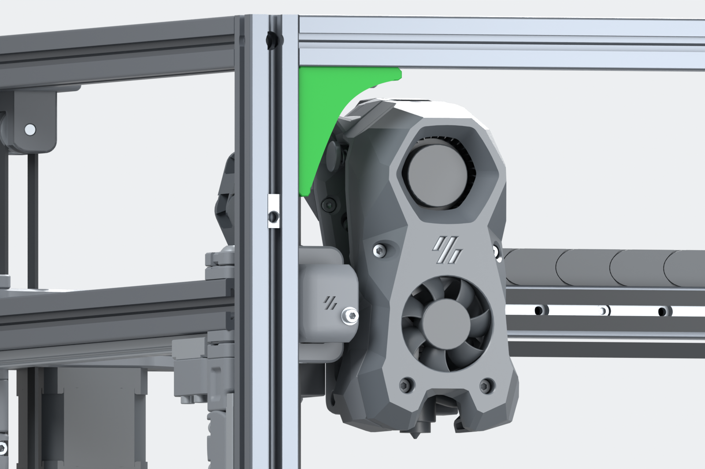
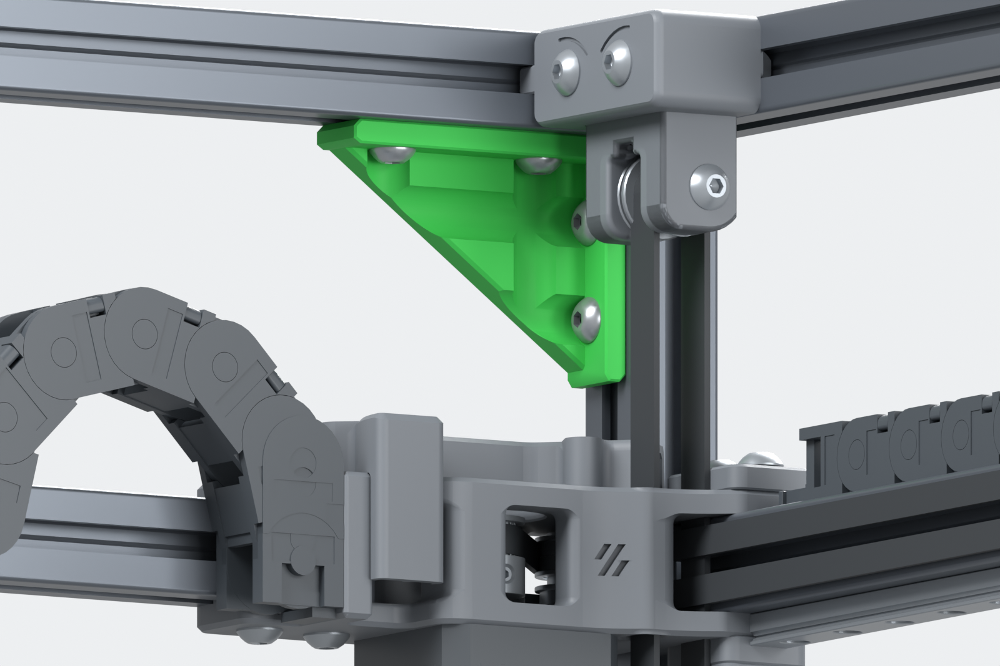

# Upper frame braces for the Voron 2.4r2

Printed corner braces that fit under the top frame bars of a Voron 2.4r2 and screw into the
slots of the top bar and the corner post. Four side braces are the main part of the mod; a pair
for the front and a pair for the rear are optional.



This is an unofficial community mod. It is not made, tested or endorsed by Voron Design. The
braces are original parts that fit Voron's frame, and they are licensed under the GPL-3.0.

**Status:** checked in Voron's 2.4r2 CAD assembly, including clearances to the moving parts at
full height. A physical test fit on a 350 mm 2.4r2 is in progress, and this line will say what
it found.

## Contents

- [Why brace the top corners](#why-brace-the-top-corners)
- [Compatibility](#compatibility)
- [What to print](#what-to-print)
- [What you need](#what-you-need)
- [Fitting](#fitting)
- [Check the clearances on your printer](#check-the-clearances-on-your-printer)
- [Clearances in the CAD model](#clearances-in-the-cad-model)
- [Limitations](#limitations)
- [Rebuilding the files](#rebuilding-the-files)
- [Credits and license](#credits-and-license)

## Why brace the top corners

The 2.4r2 frame is held together by blind joints: each bar end is pulled against its corner post
by a single M5 screw, and only friction stops it sliding. The four Z belts run up to idlers on
the top side bars, so their tension pulls those bars down at all four corners, all the time.
On some printers the joints slowly give, the side bars creep down the posts, and the Z belts go
slack.

A brace adds a second path for that load: it is screwed into the underside of the top bar and
into the face of the corner post, so the bar cannot slide down the post without shearing two
screws through the plastic.

**The braces do not replace tight frame joints.** If your frame joints have moved, square the
frame and tighten all 16 blind joints first, then fit the braces.

- **Side braces, recommended.** One under each side bar, at each corner. They brace the bars
  the Z belts pull on, where the load enters the frame.
- **Rear braces, optional.** A pair under the rear top bar, which takes some of the same load
  through the rear idlers.
- **Front braces, optional.** An arched pair under the front top bar, shaped to clear the
  toolhead at the front corners.

## Compatibility

- Voron 2.4r2 with Voron's 2020 aluminium frame and its standard top-corner hardware.
- **250, 300 and 350 mm builds.** Checked in CAD on all three with Voron's stock parts, up to
  Voron's Z limits of 210, 260 and 310 mm. If your Z limit is set higher than that, check the
  clearances yourself.
- **Stock idlers, or the Beefy front idlers and Beefy Z idlers** from clee's VoronBFI mod (the
  Beefy idlers were checked on the 350 mm build).
- **Not with Voron's stock Y cable chain at the rear-right corner.** The rear-right side brace
  hits the end of the stock Y cable chain, where the chain bolts to the gantry, near the back of
  the travel with the gantry at full height. If your printer has the stock Y chain, leave that
  one brace off. The other three side braces and both optional pairs clear the chain, so you can
  still fit the optional rear brace at that corner. Printers whose cables run in an umbilical
  instead of chains are not affected.
- Voron's stock panel clips and door hinges were checked, and so were the closed panels, clips
  and trim of the Monolith Panels v71 kit (its 250 mm CAD model), with about 1.6 mm to spare to
  its foam. Its hinges were not checked.
- Anything else near the top corners has not been checked: other toolheads, probes, umbilical
  mounts, other cable chains and their brackets, filament sensors, LED bars, and other panel
  kits, hinges and trim. The [clearance check](#check-the-clearances-on-your-printer) below is
  how to find out on your own printer.

## What to print



Left and right are as seen standing in front of the printer.

| File | Where it goes | Quantity |
| --- | --- | --- |
| **Side braces, recommended** | | |
| `STLs/Side/upper_brace_side_front_left.stl` | front-left corner, under the left side bar | 1 |
| `STLs/Side/upper_brace_side_front_right_rear_left_x2.stl` | front-right and rear-left corners | 2 |
| `STLs/Side/upper_brace_side_rear_right.stl` | rear-right corner, under the right side bar; its post leg is shorter. **Not for printers with Voron's stock Y cable chain**, see [Compatibility](#compatibility) | 1 |
| **Front braces, optional** | | |
| `STLs/Front_Optional/upper_brace_front_left.stl` | front-left corner, under the front bar | 1 |
| `STLs/Front_Optional/upper_brace_front_right.stl` | front-right corner, under the front bar | 1 |
| **Rear braces, optional** | | |
| `STLs/Rear_Optional/upper_brace_rear_left.stl` | rear-left corner, under the rear bar | 1 |
| `STLs/Rear_Optional/upper_brace_rear_right.stl` | rear-right corner, under the rear bar | 1 |

The side braces are 65 mm along the bar, 50 mm down the post (41 mm for the rear-right one) and
15 mm wide. The rear braces are 65 by 50 by 15 mm and the front braces 42 by 50 by 15 mm.

### Print settings

- ABS or ASA.
- 0.2 mm layers, 5 walls, **100 % infill**. These parts carry load, so print them solid.
- Print flat, exactly as the file is oriented, with the broad flat face on the bed. No supports:
  the screw holes have pointed roofs that bridge cleanly.

## What you need

For **each brace**:

- 4 × M5 × 10 mm button-head screws. The length is measured under the head. Do not use longer
  screws: they bottom out in the slot and feel tight without clamping the brace.
- 4 × M5 roll-in or drop-in T-nuts for 2020 extrusion (6 mm slot). Nuts no larger than
  13 × 7.7 × 4.3 mm are what was checked in CAD; larger ones may touch the idler mounts.
- A 3 mm hex key with a straight shaft, long enough to reach through the brace's screw pockets.

| What you fit | Screws | T-nuts |
| --- | --- | --- |
| The four side braces | 16 | 16 |
| Plus the front pair | 8 more | 8 more |
| Plus the rear pair | 8 more | 8 more |

## Fitting

### Before you start

1. Turn the printer off and let it cool.
2. If the frame joints have moved, square the frame and tighten its joints first. The braces
   hold the frame where it is; they do not pull it back into square.

### Fit one brace



1. Hold the panel, its trim and any foam up to the frame at that corner first, and check they
   still sit normally there. Note anything that might be in the way, such as panel clips or a
   door hinge.
2. Find the right brace for the corner from the table and the map above.
3. Put the long leg under the top bar and the other leg against the corner post, on the face of
   the post that looks along that same bar towards its middle. For the side braces, that means
   behind the post at the front corners and in front of the post at the rear corners. The broad
   flat face (the one that was on the print bed) faces the panel on that side, and the screw
   pockets open into the printer.
4. Offer the brace up without screws and check the holes line up with the slots, and that the
   screw heads and T-nuts will not meet the idlers, their bolts or any other hardware nearby.
5. Roll or drop the four T-nuts into the slots from the open face, two in the bar and two in the
   post, and start all four screws loosely by hand.
6. Push the brace firmly into the corner, so both legs sit flat against the frame, and tighten
   the four screws with the hex key through the pockets: firm, but do not crush the plastic.
   If a screw feels tight while the brace can still move, it has probably bottomed out; check
   the screw length and the T-nut.
7. Never move or loosen the Z belt idlers to make a brace fit. If a brace touches an idler,
   leave that brace off and find out why.
8. Refit the panel at that corner, and check the panel, its trim and foam, and any door hinge
   against the brace and its screws, including through a door's full swing. If anything
   touches or will not seat, take the brace off until the cause is understood.

The front and rear braces fit the same way, under the front and rear bars. The front pair are
arched so that the toolhead can pass under them.




## Check the clearances on your printer

The CAD check covers Voron's stock parts and the Beefy idlers, as solid parts. Your printer has its own
toolhead, cables and accessories, so check it yourself before printing anything. Do it slowly,
one small move at a time, standing at the printer and ready to switch it off.

1. Home and level the printer as usual: `G28`, `QUAD_GANTRY_LEVEL`, then `G28 Z`.
2. Move the toolhead to the middle of the bed, then raise the gantry in steps of 20 mm, slowly,
   for example `G1 Z100 F600`, then `G1 Z120 F600`, and so on. Look at all four corners after
   each step.
3. Near the top, use steps of 5 mm up to your `position_max` for Z (Voron's default is 210 mm
   on the 250, 260 mm on the 300 and 310 mm on the 350). Watch the gantry corners, the idlers,
   the belts and the cable chain as they come up beside the braces.
4. At full height, move the toolhead slowly, at about `F1200`, to each front corner, along the
   rear, and to any position your macros park it at (for example the middle of the rear).
   Watch the toolhead, its cables, the filament tube and the cable chain near each brace.
5. Stop at once if a gap is closing faster than you expected, or if anything touches, rubs or
   catches. Do not start a print to find out whether it fits.

## Clearances in the CAD model

These are distances in Voron's 2.4r2 CAD assembly, at the printer's full height and its travel
limits. They are not measurements of a real printer: real parts vary by a millimetre or so,
and cables and chains flex.

### With Voron's stock parts (250, 300 and 350 mm builds)

The gaps to moving parts allow for 2 mm of travel past the printer's limits and for where a
builder sets the X and Y zero points.

| Brace | Nearest moving part | Nearest fixed part |
| --- | --- | --- |
| Side, front-left | 6.36 mm to the turning upper Z pulley | 1.80 mm from a brace T-nut to the frame-joint screw |
| Side, front-right | 4.75 mm to the end of the Y cable chain | 1.80 mm to the frame-joint screw |
| Side, rear-left | 6.36 mm to the turning upper Z pulley | 1.80 mm to the frame-joint screw |
| Side, rear-right | **Hits the end of the stock Y cable chain**; see [Compatibility](#compatibility) | 1.80 mm to the frame-joint screw |
| Front, left | 7.48 mm to the Stealthburner shroud | 1.50 mm to the closed door |
| Front, right | 8.11 mm to the Stealthburner shroud | 1.50 mm to the closed door |
| Rear, left | 20.85 mm to the turning upper Z pulley | 1.80 mm to the frame-joint screw |
| Rear, right | 12.01 mm to the A drive's moving cable cover | 1.80 mm to the frame-joint screw |

- The Z belt beside the pulley is 8.61 mm from the side braces. The side braces have a 1.5 mm
  recess along the edge next to the Z pulley, which adds about 0.85 mm of room there, and a
  3.5 mm setback on the inside that keeps 3.5 mm between the brace and the fixed Z belt idler.
- The Z cable chain and its mounts stay at least 17.55 mm from every brace.
- The screw heads and T-nuts clear the stock hardware whichever way a roll-in T-nut turns. The
  tightest gap is about 1.4 mm, from a front brace's nut to a door-hinge nut, and a panel clip's
  nut is about 2.9 mm from a brace's nut.
- The stock door hinge and its tape stay at least 4.4 mm from the front braces through the
  door's full outward swing.

### With the Beefy front and Z idlers (350 mm build)

Only the gaps to the Beefy idlers differ from the stock build above.

| Brace | Nearest Beefy part | Gap |
| --- | --- | --- |
| Side | Beefy Z idler pulley, turning | 4.18 mm |
| Side | Z belt running beside it | 5.09 mm |
| Side | Beefy Z idler body, fixed | 3.50 mm |
| Side | First T-nut in the bar, to the idler mount | 2.15 mm |
| Side | Beefy front idlers, moving | 19.37 mm left, 17.24 mm right |
| Front | Beefy front idlers, moving | 24.43 mm left, 14.44 mm right |
| Front | Beefy front idler bodies, fixed | 2.70 mm left, 2.50 mm right |
| Front | First T-nut in the bar, to the idler body | 1.95 mm left, 1.81 mm right |
| Rear | Beefy idler bodies, fixed | about 3.5 mm left, 3.7 mm right |

## Limitations

- Checked in CAD against Voron's stock parts and the Beefy idlers. Other parts near the top
  corners are not checked; see [Compatibility](#compatibility).
- The rear-right side brace does not fit printers with Voron's stock Y cable chain.
- Flexible parts, such as the links of the X and Y cable chains, wires and the filament tube,
  were not checked as they move. Watch them during the [clearance check](#check-the-clearances-on-your-printer).
- The braces stop a bar sliding down its post. They do not square a frame that is already out
  of square, and they are no substitute for tight frame joints.
- No strength testing has been done beyond the physical test fit described in the status line.

## Rebuilding the files

The braces are made by a Python script, so anyone can check or change them. You need
[uv](https://docs.astral.sh/uv/). From the repository root:

```sh
uv run --with manifold3d==3.5.5 --with numpy==2.5.5 python -I CAD/make_braces.py
```

This writes the seven STLs into the `Side`, `Front_Optional` and `Rear_Optional` folders under
`STLs/`; with the default settings they are byte-for-byte identical to the files in this
repository. `--bar` and `--post` change the length of the rear braces' legs, in millimetres
(44 mm or more, so each leg keeps two screws). Check the clearances again if you change them.

`CAD/STEP/` holds STEP versions of the seven braces for anyone who wants to remix them in a CAD
program. They are converted from the meshes: flat faces are true planes, but curved faces stay
faceted, so the script is the better place to make changes.

## Credits and license

- Design: ChanceTheHacker, 2026, for the [Voron 2.4r2](https://vorondesign.com) by Voron Design.
- Clearances were checked against Voron Design's 2.4r2 CAD assembly
  ([VoronDesign/Voron-2](https://github.com/VoronDesign/Voron-2)) and clee's VoronBFI idlers.

This mod, including the STLs, STEP files and script, is licensed under the GNU General Public
License v3.0. See [LICENSE](LICENSE).
